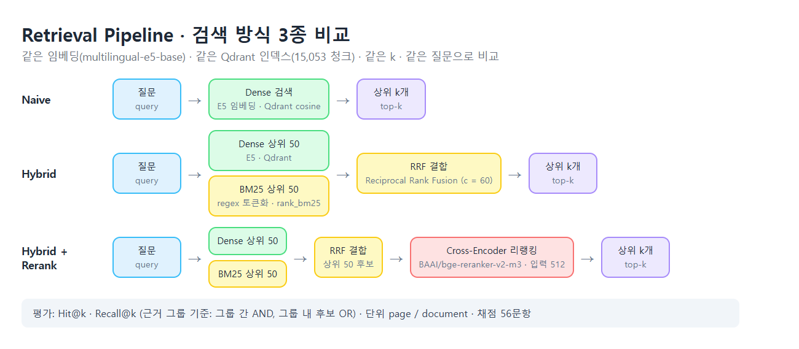

# shipping_rag · 검색 품질 개선과 평가

> **핵심 결과**: 같은 인덱스·같은 56문항·같은 k=5에서 **Hybrid + Rerank는 Naive 대비 page Recall@5가 0.619 → 0.676 (+0.057, 약 5.7%p), page Hit@5가 0.911 → 0.964** 올랐습니다.
> 이 수치는 검색 단계가 정확한 근거 페이지를 가져오는 비율이며, 최종 답변의 정확도가 아닙니다.

[← 포트폴리오 첫 화면](../../README.md) · [회고](retrospective.md) · [팀 원본 저장소](https://github.com/kant-proj3-team3/shipping_rag)

## 1. 프로젝트 개요와 내 담당

해운 PDF 50개(3,750페이지)에서 근거를 찾아 답하고, 답변에 **문서명·페이지 출처**를 붙이는 RAG Q&A 서비스입니다. KANT 프로젝트 3, 4인 팀, 2026.11.05 ~ 11.13에 진행했습니다.

팀 성과와 내 담당을 구분하면 다음과 같습니다.

| 구분 | 내용 |
|---|---|
| **내 담당 (Retrieval)** | Naive(Dense), Hybrid(BM25 + RRF), Hybrid + Rerank 구현 · 근거 그룹 평가기 · 검색 품질 보고서 · 추가 실험(리랭커 입력 한도, CPU/GPU, BM25 한국어 토큰화) |
| 팀 (내 담당 아님) | PDF 청킹·임베딩·Qdrant 색인, 답변 생성·검증·세션·프롬프트 개선, API, 프론트 화면 |

팀 레포의 모듈은 서로 import하지 않고 `packages/common` 계약만 참조하며, 내 모듈은 `Retriever.retrieve()` 하나로 백엔드에 연결됩니다.

## 2. 검색 파이프라인

세 방식은 **같은 임베딩(multilingual-e5-base) · 같은 Qdrant 인덱스(청크 15,053개) · 같은 k · 같은 질문**으로 실행되고, 방식은 `mode` 값으로만 바뀝니다.

## 3. 구현

| 구현 | 설명 | 코드 (커밋 `39a8410` 고정) |
|---|---|---|
| Naive (Dense) | 질문을 E5로 임베딩해 Qdrant에서 가까운 k개를 가져옴. 오류는 계약대로 `IndexNotReadyError`, `InvalidInputError`, `RetrievalError`로 구분 | [`dense.py`](https://github.com/kant-proj3-team3/shipping_rag/blob/39a8410305e3f8ada258c8f85516bd6f2e820829/packages/retrieval/src/retrieval/dense.py#L26) |
| Hybrid | Dense 상위 50 + BM25 상위 50을 RRF(상수 60)로 결합. BM25는 시작 시 Qdrant 청크로 메모리에 `rank_bm25` 색인을 만듦 | [`hybrid.py`](https://github.com/kant-proj3-team3/shipping_rag/blob/39a8410305e3f8ada258c8f85516bd6f2e820829/packages/retrieval/src/retrieval/hybrid.py#L61) (`rrf_fuse`, `Bm25Index`, `HybridRetriever`) |
| Hybrid + Rerank | RRF 상위 50개를 `BAAI/bge-reranker-v2-m3`로 다시 채점해 상위 k개 선택. 청크 한도와 리랭커 입력 한도(512) 불일치를 시작 시 검사 | [`reranker.py`](https://github.com/kant-proj3-team3/shipping_rag/blob/39a8410305e3f8ada258c8f85516bd6f2e820829/packages/retrieval/src/retrieval/reranker.py#L16) |
| 검색 평가기 | 근거 그룹 단위 Hit@k / Recall@k. 단위(`page` / `document`)는 호출자가 명시(기본값 없음). 근거 없음은 `not_applicable`, 호출 실패는 `unavailable`로 분리해 평균에서 제외하고 건수를 보고 | [`evaluator.py`](https://github.com/kant-proj3-team3/shipping_rag/blob/39a8410305e3f8ada258c8f85516bd6f2e820829/packages/retrieval/src/retrieval/evaluator.py#L52) |

설계 결정

- **BM25는 검색 모듈 안에서 처리**했습니다. Qdrant sparse vector는 청킹 담당과 계약 조율이 필요하지만 `rank_bm25`는 `Chunk.text`만 있으면 되어 협의 없이 끝납니다. 청크 15,053개는 메모리 BM25로 충분한 규모입니다.
- **근거 그룹 채점**: 그룹끼리는 AND, 그룹 안 후보는 OR로 채점했습니다.
- **재현 정보 기록**: 평가 보고서에 `index_fingerprint`, `golden_fingerprint`를 남겨, 다른 인덱스·다른 데이터의 결과와 비교하지 않도록 했습니다.

## 4. 평가 설정

| 항목 | 값 |
|---|---|
| 데이터 | PDF 50개, 청크 15,053개 |
| 문항 | 60문항 중 **56문항 채점** (근거 그룹이 없는 4문항은 `not_applicable`로 제외), 근거 그룹 178개 |
| 지표 | Hit@k (적중률), Recall@k (재현율) |
| 단위 | `page`: 검색된 청크의 페이지 범위가 근거 페이지를 포함 / `document`: 문서가 같음 |
| 환경 | RTX 5060 Laptop GPU, torch 2.14.1+cu130 |

## 5. 결과

**page 기준 (정확한 근거 페이지)**

| 방식 | Hit@5 | Hit@10 | Recall@5 | Recall@10 | Recall@20 |
|---|---|---|---|---|---|
| Naive | 0.911 | 0.982 | 0.619 | 0.689 | 0.733 |
| Hybrid | 0.875 | 0.946 | 0.596 | 0.700 | 0.794 |
| **Hybrid + Rerank** | **0.964** | **0.982** | **0.676** | **0.765** | **0.808** |

**document 기준 (근거 문서)**

| 방식 | Hit@5 | Recall@5 | Recall@10 | Recall@20 |
|---|---|---|---|---|
| Naive | 1.000 | 0.726 | 0.789 | 0.849 |
| Hybrid | 0.982 | 0.736 | 0.823 | 0.897 |
| **Hybrid + Rerank** | 1.000 | **0.785** | **0.863** | **0.899** |

해석

1. **Hybrid + Rerank가 page, document 모두 모든 k에서 Recall이 가장 높았습니다.** 효과는 작은 k에서 큽니다. 리랭커는 후보 50개의 순서만 바꾸므로 k가 커질수록 Hybrid와 비슷해집니다(document k=20: 0.899 vs 0.897).
2. **Hybrid가 항상 Naive보다 낫지는 않았습니다.** page k=5에서는 Hybrid가 더 낮고(0.596 < 0.619), document에서는 모든 k에서 더 높습니다. BM25가 맞는 문서는 가져오지만 상위 5개 안에 정확한 페이지를 넣지 못하는 경우가 있었습니다.
3. **맞는 문서를 찾고도 페이지를 놓칩니다.** 세 방식 모두 page Recall이 document Recall보다 0.09 ~ 0.14 낮았고, 근거 그룹 178개 중 16 ~ 21개(9 ~ 12%)가 "문서는 맞고 페이지가 틀린" 경우였습니다.
4. document Hit는 거의 모든 곳에서 1.000이라 방식을 구분하지 못해, 방식 비교는 Recall로 했습니다.

처리 시간: 리랭킹이 검색 시간의 대부분을 차지했습니다. GPU에서 질문당 약 1.3초, CPU(api 기본 실행 환경)에서는 질문당 8 ~ 17초였습니다.

## 6. 추가 실험과 결정

| 실험 | 결과 | 결정 |
|---|---|---|
| CPU vs GPU | 문항별 결과 차이 0 / 60 | 점수는 기기와 무관 |
| 리랭커 입력 한도 512 / 1024 / 2048 | 점수 변화 0 / 56, 가장 긴 입력 504토큰 | **512 유지** |
| BM25 토큰화 regex / josa / kiwi | kiwi는 BM25 50위 안 근거 그룹을 133개에서 144개로 늘렸지만 최종 Hit·Recall 변화는 대부분 ±0.02 이내이고 방향이 엇갈림 | **regex 유지** |

실패한 시도의 자세한 과정은 [회고](retrospective.md)에 정리했습니다.

## 7. 한계

- **재현 제한**: 원본 PDF와 평가용 골든 문항 파일(`data/`)은 저장소에 공개되어 있지 않아, 이 저장소만으로 평가 전체를 재현할 수는 없습니다. 공개된 것은 코드, 보고서, 방식별·k별 평가 결과 JSON입니다.
- **표본이 작습니다.** 채점 문항이 56개라 0.02 안팎의 차이는 우연과 구분하기 어렵습니다.
- **Recall 상한**: 근거 그룹이 6개 이상인 문항은 k=5에서 Recall 만점이 구조적으로 어렵습니다.
- **정답 근거가 하나뿐인 문항**(예: `IS-ADD-10`)은 같은 뜻의 다른 페이지를 찾아도 page 기준으로 0점입니다. 검색 점수는 답변 품질을 그대로 대변하지 않습니다.
- 추가 실험(CPU·GPU 비교, BM25 토큰화)은 page 기준만 확인했고, 평가는 현재 저장소 환경(torch 2.11.0)이 아니라 torch 2.14.1 환경에서 돌렸습니다.

## 8. 소스와 평가 근거

모든 링크는 팀 저장소의 커밋 [`39a8410`](https://github.com/kant-proj3-team3/shipping_rag/commit/39a8410305e3f8ada258c8f85516bd6f2e820829) 기준입니다.

**평가 근거**

| 내용 | 링크 |
|---|---|
| 검색 품질 보고서 (이 문서의 표 원본) | [`retrieval_quality_report.md`](https://github.com/kant-proj3-team3/shipping_rag/blob/39a8410305e3f8ada258c8f85516bd6f2e820829/packages/retrieval/report/retrieval_quality_report.md) |
| 방식별 평가 원본 JSON (page) | [`eval_k5_page_gpu.json`](https://github.com/kant-proj3-team3/shipping_rag/blob/39a8410305e3f8ada258c8f85516bd6f2e820829/packages/retrieval/report/eval_k5_page_gpu.json) · [`k10`](https://github.com/kant-proj3-team3/shipping_rag/blob/39a8410305e3f8ada258c8f85516bd6f2e820829/packages/retrieval/report/eval_k10_page_gpu.json) · [`k20`](https://github.com/kant-proj3-team3/shipping_rag/blob/39a8410305e3f8ada258c8f85516bd6f2e820829/packages/retrieval/report/eval_k20_page_gpu.json) |
| 방식별 평가 원본 JSON (document) | [`eval_k5_document_gpu.json`](https://github.com/kant-proj3-team3/shipping_rag/blob/39a8410305e3f8ada258c8f85516bd6f2e820829/packages/retrieval/report/eval_k5_document_gpu.json) · [`k10`](https://github.com/kant-proj3-team3/shipping_rag/blob/39a8410305e3f8ada258c8f85516bd6f2e820829/packages/retrieval/report/eval_k10_document_gpu.json) · [`k20`](https://github.com/kant-proj3-team3/shipping_rag/blob/39a8410305e3f8ada258c8f85516bd6f2e820829/packages/retrieval/report/eval_k20_document_gpu.json) |
| 리랭커 입력 한도 실험 | [`reranker_max_tokens.md`](https://github.com/kant-proj3-team3/shipping_rag/blob/39a8410305e3f8ada258c8f85516bd6f2e820829/packages/retrieval/report/reranker_max_tokens.md) |
| BM25 토큰화 비교 | [`variants/summary.md`](https://github.com/kant-proj3-team3/shipping_rag/blob/39a8410305e3f8ada258c8f85516bd6f2e820829/packages/retrieval/report/variants/summary.md) |
| 개선 시도 기록 | [`improvement_log.md`](https://github.com/kant-proj3-team3/shipping_rag/blob/39a8410305e3f8ada258c8f85516bd6f2e820829/packages/retrieval/report/improvement_log.md) |
| 모듈 README | [`packages/retrieval/README.md`](https://github.com/kant-proj3-team3/shipping_rag/blob/39a8410305e3f8ada258c8f85516bd6f2e820829/packages/retrieval/README.md) |

**내가 작성한 PR** (작성자 `chanyeongg3-design`, 모두 `dev`에 병합됨을 확인)

| PR | 내용 |
|---|---|
| [#8](https://github.com/kant-proj3-team3/shipping_rag/pull/8) | Naive(Dense) 검색 부품과 Qdrant 접속 |
| [#10](https://github.com/kant-proj3-team3/shipping_rag/pull/10) | 하이브리드 검색(BM25 + RRF) |
| [#16](https://github.com/kant-proj3-team3/shipping_rag/pull/16) | 하이브리드 + 리랭킹(cross-encoder) |
| [#19](https://github.com/kant-proj3-team3/shipping_rag/pull/19) | 근거 그룹 평가기와 `RETRIEVAL_IMPL` 연결 |
| [#38](https://github.com/kant-proj3-team3/shipping_rag/pull/38) | 검색 품질 평가 보고서 |
| [#43](https://github.com/kant-proj3-team3/shipping_rag/pull/43) | retrieval README를 실제 색인 평가 결과에 맞게 갱신 |
| [#45](https://github.com/kant-proj3-team3/shipping_rag/pull/45) | 보고서 결론에 page·document 비교표와 document 평가 원본 추가 |

팀 프로젝트의 답변 평가와 프롬프트 개선 결과는 팀 레포의 [`prompt-engineering.md`](https://github.com/kant-proj3-team3/shipping_rag/blob/39a8410305e3f8ada258c8f85516bd6f2e820829/packages/backend/report/prompt-engineering.md)에 있으며, 내가 작성한 부분이 아니므로 이 문서의 성과에 포함하지 않았습니다.
