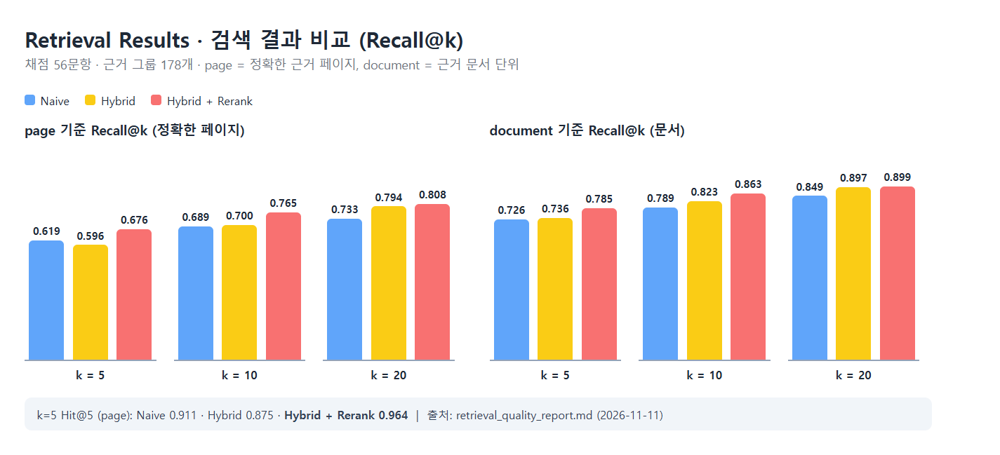

# shipping_rag · 해운 문서 RAG Q&A

> KANT 프로젝트 3 (팀 3, 4인) · 2026.11.05 ~ 2026.11.13
> 제공된 해운 PDF(50개, 3,750페이지)에서 근거를 찾아 답하고, 답변에 **문서명·페이지 출처**를 붙이는 RAG Q&A 서비스입니다.
> 근거가 부족하면 되묻거나 답변을 보류합니다.

- 팀 레포: [kant-proj3-team3/shipping_rag](https://github.com/kant-proj3-team3/shipping_rag)
- 회고: [retrospective.md](retrospective.md)
- 원본 보고서: [검색 품질 보고서](https://github.com/kant-proj3-team3/shipping_rag/blob/main/packages/retrieval/report/retrieval_quality_report.md) · [프롬프트 개선 보고](https://github.com/kant-proj3-team3/shipping_rag/blob/main/packages/backend/report/prompt-engineering.md)

## 한눈에 보기

| 항목 | 내용 |
|---|---|
| 문제 | 해운 규정 문서에서 질문의 근거를 정확한 문서·페이지 단위로 찾아 답변해야 함 |
| 내 역할 | **검색(Retriever) 모듈**: 검색 방식 3종 구현, 검색 품질 평가, 추가 실험(리랭커 입력 한도, BM25 토큰화) |
| 핵심 결과 | Hybrid + Rerank가 모든 k에서 가장 높음. k=5 page Hit@5 **0.964**, Recall@5 **0.676** |
| 스택 | Python 3.12 · Qdrant · multilingual-e5-base · rank_bm25 · bge-reranker-v2-m3 · FastAPI · Redis · PostgreSQL · Langfuse · React · Docker |

## 시스템 구조

```text
PDF ─▶ chunking ─▶ Qdrant 인덱스 ─▶ retrieval ─▶ backend ─▶ HTTP(/query) ─▶ frontend
       (청킹·임베딩·색인)           (검색 3종·검색 평가)  (답변 생성·검증·세션·답변 평가)   (React)
```

- 모듈(chunking / retrieval / backend)은 서로 import하지 않고 `packages/common` 계약만 봅니다. 이 규칙은 `import_lint.py`로 검사합니다.
- 모듈 사이로 데이터가 지나는 길은 셋뿐입니다: 청킹 → 검색은 Qdrant 인덱스, 검색 → 백엔드는 `Retriever.retrieve()`, 백엔드 → 프론트는 HTTP `QueryResponse`.
- 브랜치는 `feat/<모듈> → dev → main` 순서로 PR을 올리고, 계약 변경은 별도 PR과 `CHANGELOG`로 관리했습니다.

## 내가 맡은 부분: Retrieval

세 검색 방식을 **같은 임베딩 · 같은 저장소 · 같은 k · 같은 질문**으로 비교할 수 있게 하나의 `Retriever` 인터페이스 뒤에 구현했습니다. 방식은 `mode`로만 바뀝니다.


| 방식 | 동작 |
|---|---|
| Naive | E5 임베딩 Dense 검색 상위 k개 |
| Hybrid | Dense 상위 50개와 BM25 상위 50개를 RRF(상수 60)로 합친 뒤 상위 k개 |
| Hybrid + Rerank | Hybrid 상위 50개를 cross-encoder(`BAAI/bge-reranker-v2-m3`)로 다시 채점한 뒤 상위 k개 |

설계 결정 몇 가지

- **BM25는 검색 모듈 안에서 처리**했습니다. Qdrant sparse vector는 청킹 담당과 계약 조율이 필요하지만, `rank_bm25`는 `Chunk.text`만 있으면 되어 협의 없이 끝납니다. 규모(청크 15,053개)도 메모리 BM25로 충분했습니다.
- **평가는 근거 그룹 단위**로 했습니다. 그룹끼리는 AND, 그룹 안의 후보는 OR로 채점합니다.
- **평가 단위를 호출자가 명시**하게 했습니다(`page` / `document`, 기본값 없음). 이렇게 하면 "문서를 못 찾는지, 페이지를 못 찾는지"를 구분할 수 있습니다.

## 평가 설정

| 항목 | 값 |
|---|---|
| 문서 / 청크 | PDF 50개 / 청크 15,053개 |
| 평가 문항 | 60문항 중 **56문항 채점**(근거 그룹이 없는 4문항 제외), 근거 그룹 178개 |
| 지표 | Hit@k(적중률), Recall@k(재현율) |
| 단위 | `page`(정확한 근거 페이지), `document`(근거 문서) |
| 재현성 | `index_fingerprint`, `golden_fingerprint`를 보고서에 기록, 같은 조건끼리만 비교 |

## 결과



page 기준 (정확한 근거 페이지)

| 방식 | Hit@5 | Hit@10 | Recall@5 | Recall@10 | Recall@20 |
|---|---|---|---|---|---|
| Naive | 0.911 | 0.982 | 0.619 | 0.689 | 0.733 |
| Hybrid | 0.875 | 0.946 | 0.596 | 0.700 | 0.794 |
| **Hybrid + Rerank** | **0.964** | **0.982** | **0.676** | **0.765** | **0.808** |

document 기준 (근거 문서)

| 방식 | Hit@5 | Recall@5 | Recall@10 | Recall@20 |
|---|---|---|---|---|
| Naive | 1.000 | 0.726 | 0.789 | 0.849 |
| Hybrid | 0.982 | 0.736 | 0.823 | 0.897 |
| **Hybrid + Rerank** | 1.000 | **0.785** | **0.863** | **0.899** |

### 해석

1. **Hybrid + Rerank가 가장 좋습니다.** page, document 모두 모든 k에서 Recall이 가장 높습니다. 효과는 작은 k에서 큽니다. 리랭커는 후보 50개의 순서만 바꾸기 때문에 k가 커질수록 Hybrid와 비슷해집니다(document k=20: 0.899 vs 0.897).
2. **Hybrid가 항상 Naive보다 낫지는 않습니다.** page k=5에서는 Hybrid가 더 낮고(Recall 0.596 < 0.619), document에서는 모든 k에서 더 높습니다. BM25가 맞는 문서는 가져오지만 상위 5개 안에 정확한 페이지를 넣지는 못하는 경우가 있기 때문입니다.
3. **맞는 문서를 찾고도 페이지를 놓칩니다.** 세 방식 모두 page Recall이 document Recall보다 0.09 ~ 0.14 낮습니다. 근거 그룹 178개 중 16 ~ 21개(9 ~ 12%)가 "문서는 맞고 페이지가 틀린" 경우였습니다.
4. **document Hit는 방식을 구분하지 못합니다.** 거의 모든 곳에서 1.000이라 방식 간 차이는 Recall로 봤습니다.

### 실패 사례: `IS-ADD-10`

모든 방식·모든 k에서 page 기준으로 끝까지 못 찾은 유일한 문항입니다. 문서(`IS04`)는 상위에 나오지만 정답 페이지(p1)를 가져오지 못했습니다.

- 질문은 날짜·장비가 있는 **구체적 사례**이고 근거는 **일반 규칙**이라 표현 차이가 큽니다.
- BM25에서는 한국어 조사(`정정합니다` ↔ `정정은`) 때문에 다른 단어로 취급됩니다.
- 근거 후보가 1개뿐이라, 같은 답을 뒷받침하는 다른 페이지를 찾아도 page 기준으로는 0점입니다.

## 추가 실험과 결정

| 실험 | 결과 | 결정 |
|---|---|---|
| CPU vs GPU | 문항별 결과 차이 0 / 60. 리랭킹 시간은 798.5초 vs 118.6초 | 점수는 기기와 무관, 속도는 GPU |
| 리랭커 입력 한도 512 / 1024 / 2048 | 점수 변화 0 / 56. 가장 긴 입력이 504토큰 | **512 유지** |
| BM25 토큰화 regex / josa / kiwi | kiwi는 BM25 단독 순위를 개선했지만 최종 Hit·Recall 변화는 대부분 ±0.02 이내, 방향도 엇갈림 | **regex 유지** (의존성 추가 대비 개선이 불분명) |

처리 시간은 리랭킹이 대부분을 차지했습니다. GPU 기준 **질문당 약 1.3초**이고, CPU에서는 질문당 8 ~ 17초였습니다.

## 팀 결과: 답변 품질과 프롬프트 개선

백엔드 쪽에서는 검색 방식을 Hybrid + Rerank, k=10으로 고정하고 프롬프트를 v2 → v3 → v4로 한 가지씩 바꿔 가며 비교했습니다. 이 부분은 팀 작업입니다.

- 같은 조건 2회 측정에서 점수가 facts 약 ±0.035, faithfulness 약 ±0.035 흔들려, **한 번의 점수 차이로 개선을 주장하지 않기로** 했습니다.
- v3는 "자료에 없다는 이유의 되묻기"를 5 ~ 7건에서 1건으로 줄였습니다. v4는 성과가 없어 사전 합의대로 **v3를 유지**했습니다.
- 남은 실패의 대부분은 프롬프트가 아니라 검색이 근거를 가져오지 못한 경우였습니다.
- 문서 속 공격 문구(간접 프롬프트 주입, 문맥 오염) 점검에서는 v3로 인한 새 문제가 관찰되지 않았습니다. 다만 문항이 2건이라 안전하다고 단정하지는 않았습니다.

## 한계

- 채점 문항이 56개라 평균 0.02 안팎의 차이는 우연과 구분하기 어렵습니다.
- 근거 그룹이 6개 이상인 문항은 k=5에서 Recall 만점이 구조적으로 어렵습니다.
- 정답 근거가 하나뿐인 문항은 같은 뜻의 다른 페이지를 찾아도 0점이라, 검색 평가가 답변 품질을 그대로 대변하지는 않습니다.
- 추가 실험(CPU·GPU 비교, BM25 토큰화)은 page 기준만 확인했습니다.

## 다음 단계

- RRF 결합 조정: BM25 순위가 좋아져도 최종 결과에 반영되지 않는 이유가 결합 단계에 있는지 확인
- 페이지 선정 개선: 문서는 맞고 페이지가 틀린 구간 줄이기
- 리랭킹 지연 줄이기: 모델 미리 불러오기, 후보 수 조정(정확도 영향 평가 필요)

## 실행 방법

팀 레포의 README를 따릅니다. 키와 DB 없이 목업으로 코드만 확인하려면 다음과 같이 실행합니다.

```bash
uv sync
uv run pytest
```
